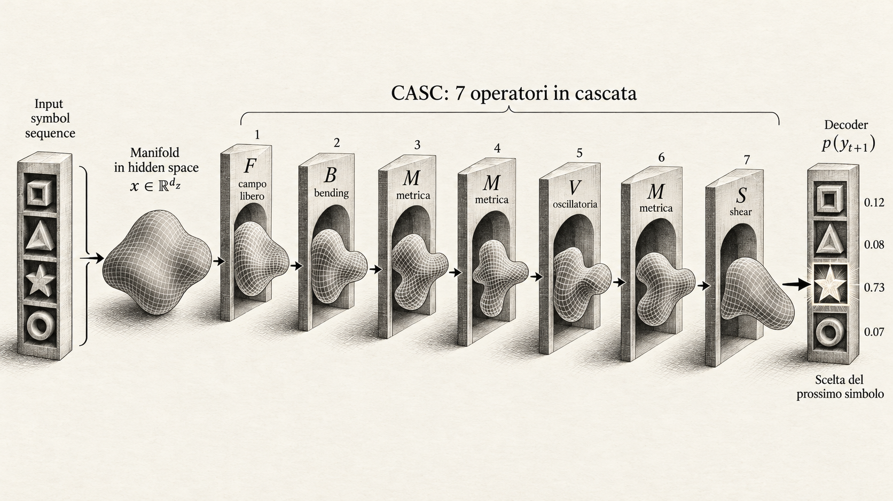
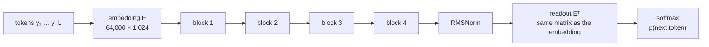
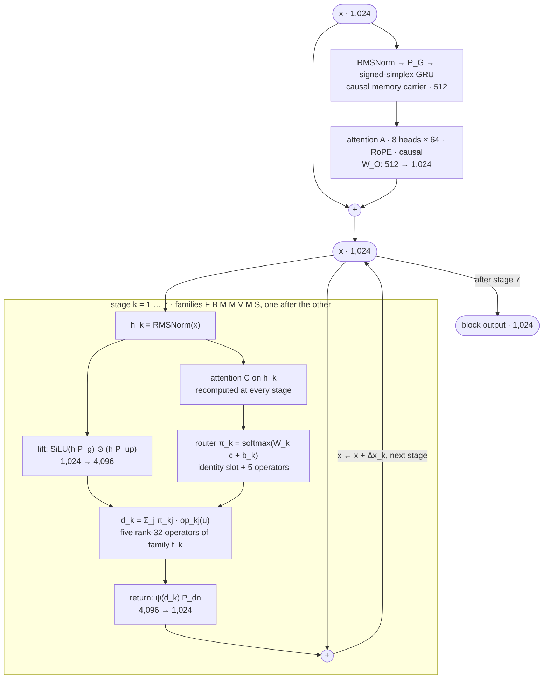
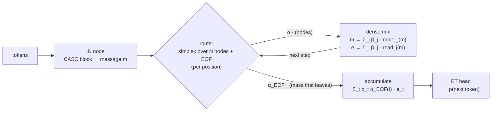

# CASC Architecture

CASC is an autoregressive language model built as a cascade of learned geometric deformations. This
repository publishes the trained 175M-parameter checkpoint CASC-NTP A (NTP_A_4B) with its results as they
were produced, together with the code that trained it and the theory behind the architecture.

## The idea - ONLY a study case to LLM comprehension

<p align="center"></p>

*Figure labels: campo libero = free field, metrica = metric, oscillatoria = oscillatory, Scelta del
prossimo simbolo = choice of the next symbol.*

CASC starts from a picture rather than from a layer recipe. Think of a baby's shape sorter: a box whose
lid has a square, a triangle, a star and a circle cut into it, and a handful of shapes to push through.

The symbols read so far are not kept as separate pieces. They become one malleable shape in a
high-dimensional hidden space, a vector of 1,024 numbers per position. Seven operators then deform that
shape one after the other: F (free field), B (bending), M (metric), M, V (oscillatory), M, S (shear).
Each operator acts on the shape already deformed by the previous ones, never on the original.

The decoder is the lid. It collapses the deformed shape back into the space we can observe, where the
only things that exist are the candidate symbols. Each hole is cut from the same embedding matrix that
turned the input symbols into a shape, and the decoder measures how well the final shape fits every one
of them. The result is a probability for each candidate: a point of a convex set, the probability simplex
over the 64,000 tokens of the vocabulary. The observable, the next symbol we actually see, is one
candidate taken from that set. In the figure it is the star, with probability 0.73, while the square,
the triangle and the circle keep 0.12, 0.08 and 0.07. The deformation happens in a space we never see;
what reaches us is the candidate it collapses onto.

The same convex structure runs through the machine. Every stage mixes an identity slot and five
operators with weights on a six-slot simplex, and the recurrent memory spreads its magnitude over a
simplex of 512 coordinates. No choice inside the machine is a hard switch; only the final observable is
a single candidate.

## Architecture

The whole machine, from tokens to the next-token distribution:



Inside one block. The hidden state stays at 1,024 dimensions; only the inside of a stage works at 4,096.



Every stage adds its projected deformation to the hidden state, and the next stage lifts, controls and
deforms the state already changed by the previous ones. `P_g`, `P_up`, `P_dn` and the control attention
C are shared by the seven stages of a block; operators and router heads belong to one stage. ψ is the
identity for S and SiLU for F, B, M and V.

| Family | Operator `op_j(u)` |
|---|---|
| F, free field | `[SiLU(u A_j) * (u B_j)] U_j^T` |
| B, bending | `SiLU(u T_j) (N_j^perp)^T`, with `N^perp = N - Q_T Q_T^T N` |
| M, metric | `[(u U_j) * phi_j(u A_j)] U_j^T`, `phi` in tanh, softsign, asinh, `z sigmoid(beta abs(z))`, SiLU |
| V, oscillatory | same form, `phi` in tanh, asinh, `sin(w z)`, `1 - cos(nu z)`, `c_s sin(w z) + c_c (1 - cos(nu z))` |
| S, shear | `(u V_j) U_j^T` |

The published configuration has 4 blocks, 7 stages, `d_x = 1024`, `d_g = 512`, `D = 4096`, rank 32 and a
64,000-token vocabulary: 175,218,812 parameters. The full mathematical specification, equation by
equation, is [docs/Architecture.pdf](docs/Architecture.pdf), built from [docs/Architecture.tex](docs/Architecture.tex).

**Training objective.** NTP, next-token prediction, is the task: at every position `i` the model reads
`y_1 .. y_i` and returns a probability for each of the 64,000 tokens as the next one. Cross-entropy (CE)
is the loss that trains it: the average negative log-probability the model gives to the token that
actually comes next, `L = -(1/N) sum_i log p(y_i+1 | y_1 .. y_i)`. The published model was trained on
this cross-entropy, with ordinary backpropagation (`loss.backward()`) and AdamW (betas 0.9 and 0.95,
weight decay 0.01, PyTorch default epsilon), global gradient clipping at 1.0 and a warmup, constant,
linear-decay schedule. The held-out MACRO reported below is the same cross-entropy, measured on text the
model never trained on.

## Status

| | Status |
|---|---|
| CASC, NTP_A_4B | Trained and finished: this repository, the report, the checkpoint on Hugging Face. |
| micro-CASC | Implemented and tested at small scale; waiting for a compute budget to train it at scale. |
| CASC on manifold | Next step. |

### Waiting for a budget: micro-CASC

micro-CASC turns the single cascade into a population of small cascades that talk to each other. Every
node is a full CASC block (`casc.py`) at a reduced width; a message in R^d enters at one node and, at
each step, a shared router places it on a **simplex over all nodes plus one EOF vertex**. The message is
sent to every node at once and the node outputs are summed, weighted by the simplex — a dense mixture,
not a discrete choice. EOF is one more vertex of that same simplex, not a threshold: the fraction of mass
on EOF leaves the machine and is read into token space by the single output head, while the rest keeps
circulating. The next-token distribution is the readout of the mass collected across steps. The routing
is computed per position, so the machine stays causal.



The directory [`micro-casc/`](micro-casc/) holds this communication and the simplex-with-EOF readout in one
file; the node law is imported from `casc.py`, never duplicated. `python micro-casc/test_micro_casc.py`
checks that each node is the published CASC block, that the machine is causal, that the EOF mass is
conserved, and that gradients flow. It is a research prototype: training it at scale is the open item.

## Repository

```
casc.py         the complete machine: memory, attentions, operators, cascade, tied readout
train.py        next-token trainer: AdamW, backpropagation, DDP, schedule, checkpoints, resume
data.py         tokenizer, corpus packing and corpus checks (three subcommands)
generate.py     inference: sampling, long-context extrapolation, streaming evaluation
test_casc.py    mathematical, regression and integration tests
tok64k.json     the 64k tokenizer of the published checkpoint
docs/           Architecture.tex and .pdf, the run report, the diagram
```

## Install and quick test

```bash
pip install -e .
```

```bash
python test_casc.py
```

The test suite runs on CPU in a few minutes. Tests that need a resource you have not supplied are
reported as NOT TESTED; set `CASC_CKPT` and `CASC_TOK` to include the published checkpoint and tokenizer.
A tiny training run on synthetic data:

```bash
SELFTEST=1 python train.py
```

## Data

Shards are JSONL files with a `text` field and an optional `domain` field.

```bash
python data.py tokenizer --code 'shards/code/*.jsonl' --noncode 'shards/web/*.jsonl' --out corpus/tok64k.json
```

```bash
python data.py pack --tok corpus/tok64k.json --out corpus --code 'shards/code/*.jsonl' --noncode 'shards/web/*.jsonl' --val-code 'val/code/*.jsonl' --val-noncode 'val/web/*.jsonl' --code-tokens 1.2e9 --noncode-tokens 2.8e9 --val-L 96
```

```bash
python data.py check corpus
```

## Training

The configuration of the published run, on six GPUs. `CODE_FRAC` is the `code_frac` that `data.py pack`
writes into `meta.json` (0.2785 for the published corpus), and `TOKENS` was one pass over the corpus, 3.59e9
prediction tokens.

```bash
FAMILY_SEQ=FBMMVMS VOCAB=64000 DX=1024 D=4096 OPRANK=32 N_BLOCKS=4 DG=512 NH=8 L=96 BS=128 ACC=1 COMPILE=1 LR=6e-4 WARM=2000 DECAY=0.15 VTOK=1e8 SEED=20260916 CODE_FRAC=0.2785 TOKENS=3.59e9 LEXT=384 TEXT=1.6e8 BSEXT=32 DATA=corpus OUT=run TAG=NTP_A_4B torchrun --nproc_per_node=6 train.py
```

`OPRANK` is the operator rank, because torchrun reserves `RANK`. The last 160M tokens train on 384-token
windows; `python train.py --help` lists every variable.

## Inference

The weights are downloaded from Hugging Face (`pip install huggingface_hub`).

```python
import torch
from huggingface_hub import hf_hub_download
from tokenizers import Tokenizer
from casc import TriplexCascadeNTP

ckpt = hf_hub_download("dredodredo/casc-geometrics-operators-LLM", "NTP_A_4B_final.pt")
tok = Tokenizer.from_file("tok64k.json")
model = TriplexCascadeNTP()
model.load_state_dict(torch.load(ckpt, map_location="cpu"), strict=True)
ids = tok.encode("The capital of France is").ids
with torch.no_grad():
    for _ in range(12):
        ids.append(int(model(torch.tensor([ids]))[0][0, -1].argmax()))
print(tok.decode(ids))   # The capital of France is the city of Paris. It is the capital of the department
```

`generate.py` runs the measurements of the report. Its sampling defaults add a repetition penalty and a
trigram ban; the published samples use pure nucleus sampling:

```bash
CK=NTP_A_4B_final.pt TOK=tok64k.json TXT=heldout MODE=sample NOBAN=1 REP=1.0 python generate.py
```

## Checkpoint

The weights are on Hugging Face, at
[dredodredo/casc-geometrics-operators-LLM](https://huggingface.co/dredodredo/casc-geometrics-operators-LLM).
The tokenizer is in this repository.

| File | Where | Content |
|---|---|---|
| `NTP_A_4B_final.pt` | Hugging Face | final state of the 13.96-hour run on 6 RTX PRO 6000, after the 384-token extension; md5 `864aa26235b68b584c8be63add0b06cf` |
| `tok64k.json` | this repository | 64k byte-level BPE tokenizer; md5 `0f773030a2ff4e2ba08cf0b8a317ccd0` |

The checkpoint loads with `strict=True` and no key translation. The model class keeps its historical name
`TriplexCascadeNTP` for that reason.

## Results

Measured on the original run, reported in full in
[docs/report.html](docs/report.html) (the first part of the run report, up to "How the cascade changed
during the run").

| Measure | NTP_A_4B |
|---|---|
| Parameters | 175.2M |
| Prediction tokens | 3.592B, one pass over the corpus |
| Optimizer steps | 49,215 |
| Training time | 13.96 h on 6 RTX PRO 6000 |
| Held-out MACRO cross-entropy | 3.4898 nat per token |
| Code / non-code cross-entropy | 2.3120 / 3.6861 |
| Nat per byte | 0.801 |

MACRO is the unweighted mean of the per-domain cross-entropy over seven held-out domains, on 96-token
windows. It is not the training loss: the last logged training CE, 2.9964, was measured on 384-token
windows during the extension. All numbers are the measurements of the run that produced the published
checkpoint, reported as they were obtained.

### Against Qwen2.5-0.5B: the difference in scale

The same held-out windows were scored by Qwen2.5-0.5B. Cross-entropy is compared in nat per byte, which
removes the difference between the two tokenizers.

| | CASC NTP_A_4B | Qwen2.5-0.5B | Ratio |
|---|---|---|---|
| Parameters | 175.2M | 494M | 2.8x fewer |
| Parameters without embedding | 109.7M | 358M | 3.3x fewer |
| Training tokens | 3.592B | about 18T | about 5,000x fewer |
| Tokens per parameter | 20.5 | about 36,000 | |
| Training compute, 6 x parameters x tokens | 3.8e18 FLOP | 5.3e22 FLOP | about 14,000x less |
| Held-out MACRO, nat per byte | 0.801 | 0.724 | 1.107x |

With 2.8 times fewer parameters and about 5,000 times fewer training tokens, CASC lands 10.7 percent
above Qwen2.5-0.5B in nat per byte. Per domain:

| Domain | CASC | Qwen2.5-0.5B | Ratio |
|---|---|---|---|
| books | 0.944 | 0.897 | 1.05 |
| reddit | 0.901 | 0.851 | 1.06 |
| pes2o | 0.723 | 0.682 | 1.06 |
| fineweb | 0.842 | 0.760 | 1.11 |
| wiki | 0.776 | 0.697 | 1.11 |
| c4 | 0.819 | 0.725 | 1.13 |
| stack (code) | 0.603 | 0.455 | 1.33 |

This is a reference point, not a controlled benchmark. The two models differ in architecture, tokenizer,
training data and budget, and whether Qwen's training data overlaps these windows is unknown. The 18T
figure is the pretraining budget reported for the Qwen2.5 series; the compute row is the usual 6ND
estimate.

## Verification

`test_casc.py` checks the release against the code that trained the checkpoint. Forward pass,
diagnostics, gradients and one AdamW step match the original sources bit for bit, at small size in both
projector modes, and the full-size initialization is identical. The published checkpoint loads strictly
and gives the reference loss. The equations of the specification are re-implemented
independently and compared. Tokenizer, packing, training with context extension and resume, two-process
data parallelism on CPU, and the three inference modes run end to end. The six-GPU NCCL launch itself
needs GPUs and is not part of the suite.

## Next steps

The current CASC implementation applies its learned geometric operators vector-wise to latent representations. The next experiment will investigate whether the same cascade can operate on an explicitly learned representation manifold, deforming the underlying geometric space while preserving the corresponding transformation of its projected points.

Proposed Architecture

CURRENT CASC — implemented and evaluated

latent vector x
   │
   ▼
   F → B → M → M → V → M → S
   │  sequential vector-wise transformations
   ▼
   updated hidden representation
   │
   ▼
   readout → softmax → observable


FUTURE CASC — experimental hypothesis

learned latent vectors x
   │
   │  Pi_in: projection into a shared learned space
   ▼
   M_0 ⊂ R^D                  initial representation manifold //same object in high dimensional space deformed into unique way the main hypothesis
   │
   │  p_0 = Pi_in(x)          projected representation
   ▼
   for k = 1..7, families F B M M V M S:

       field_k = Operator_k(M_k, context)
       M_(k+1) = Deform(M_k, field_k)
       p_(k+1) = Transport(p_k, M_k → M_(k+1))

       the next operator acts on the updated geometry

   │
   ▼
   M_7, p_7                  deformed manifold and transported point
   │
   │  Pi_out: projection back into hidden space
   ▼
   reconstructed hidden representation
   │
   ▼
   RMSNorm → E^T → softmax → observable


The experiment aims to determine whether the same CASC operator cascade, applied as successive deformations of a learned geometric space, can reproduce the corresponding vector-wise transformations while providing a more expressive representation geometry.

The existing recurrent memory, attention mechanisms, operator ordering, and decoding architecture are preserved.

Current: learned transformations of individual latent vectors.

Next experiment: projection of latent representations onto a learned manifold, successive manifold deformations, consistent transport of the projected points, and projection back to obtain the final observable.


## License

GNU General Public License v3.0, see [LICENSE](LICENSE).
